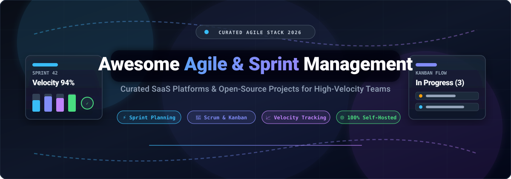

# 🚀 Awesome Agile Project & Sprint Management

**The ultimate curated directory of open-source project management systems, agile boards, sprint planning tools, and enterprise SaaS platforms.**

  
  
  
  
  
  
  

  🎯 <b>Sprint Planning</b> • 📋 <b>Backlog Grooming</b> • 📊 <b>Kanban & Scrum Boards</b> • 📈 <b>Velocity Tracking</b> • 🤝 <b>Agile Ceremonies</b>

🌟 *If you find this repository valuable, please star it and share with your team!* 🌟

---

## 📌 Executive Summary

This repository indexes the highest-performing **open-source repositories** and **enterprise SaaS platforms** for modern **Agile Project Management, Sprint Execution, and Scrum Ceremonies**. Whether your engineering organization requires an air-gapped self-hosted Scrum workspace, an opinionated keyboard-first tracker, or an enterprise strategic portfolio suite with SAFe alignment, this guide equips you with verified features, live GitHub star benchmarks, and transparent pricing intelligence.

---

## 📑 Table of Contents

- [📊 Sector Overview & Market Dynamics](#-sector-overview--market-dynamics)
- [💻 Open-Source GitHub Projects](#-open-source-github-projects)
  - [Top Agile & Sprint Repositories (Ranked by Stars)](#top-agile--sprint-repositories-ranked-by-stars)
  - [Additional Strong Open-Source Alternatives](#additional-strong-open-source-alternatives)
- [🏢 SaaS / Hosted Agile Platforms](#-saas--hosted-agile-platforms)
- [🤝 How to Contribute](#-how-to-contribute)
- [💖 Support & Sponsorship](#-support--sponsorship)
- [⭐ Star History](#-star-history)
- [⚠️ Disclaimer](#️-disclaimer)

---

## 📊 Sector Overview & Market Dynamics

The global agile project management software market was valued between **$5.2B and $5.7B in 2024** and is projected to expand toward **$9.8B by 2026** at a compound annual growth rate (**CAGR**) of **~13–14%** (operating within the broader ~$12B collaborative work management space). 

The sector is **moderately fragmented**: 
- **Concentrated Enterprise Tier:** Incumbent mega-caps and category SaaS leaders (Microsoft, Atlassian, monday.com, IBM/Apptio) control approximately **48% of total market revenue**, driven by deep corporate IT integrations, enterprise security certifications, and AI-enabled roadmapping.
- **The Competitive Long Tail:** The remaining market is distributed across high-momentum modern tools (such as Linear and ClickUp) and self-hosted open-source software (such as Plane, Focalboard, OpenProject, and WeKan). This segment is winning strong developer mindshare by offering keyboard-centric UX, transparent local-first data ownership, and freedom from per-seat enterprise lock-in.

---

## 💻 Open-Source GitHub Projects

Explore the finest self-hosted agile project management suites, Scrum ceremony frameworks, and lightweight Kanban engines—ranked by popularity (**GitHub_Stars descending**).

### Top Agile & Sprint Repositories (Ranked by Stars)

1. **[Plane](https://github.com/makeplane/plane)**  🌟
   - **Description**: An extensible, modern open-source Jira and Linear alternative with a lightning-fast UI. Supports project cycles (sprints), work modules, issue triage, burn-down metrics, and rich-text Pages.
   - **Tech Stack**: Next.js, TypeScript, Python, PostgreSQL, Redis • **License**: AGPL-3.0
   - **Deployment**: Docker Compose, Kubernetes, or Plane Cloud.
   - **Trade-off**: Tailored for agile product and engineering teams; lacks heavy enterprise financial portfolio/cost governance.

2. **[Focalboard](https://github.com/mattermost-community/focalboard)**  🌟
   - **Description**: An open-source, multilingual, self-hosted alternative to Trello, Notion, and Asana developed by Mattermost. Provides Kanban boards, sprint cards, calendar schedules, and table views.
   - **Tech Stack**: TypeScript, React, Go, SQLite/PostgreSQL • **License**: AGPL-3.0 / Apache-2.0
   - **Deployment**: Standalone server, Docker, or integrated inside Mattermost.
   - **Trade-off**: Primarily task- and board-oriented; lacks built-in planning poker and advanced SAFe ceremony automation.

3. **[WeKan](https://github.com/wekan/wekan)**  🌟
   - **Description**: Mature, battle-tested open-source collaborative Kanban board with swimlanes, custom fields, WIP limits, subtasks, checklists, and zero telemetry.
   - **Tech Stack**: Meteor, JavaScript, MongoDB • **License**: MIT
   - **Deployment**: Docker, Snap, Sandstorm, Kubernetes, Univention.
   - **Trade-off**: Classical Kanban focus; does not feature dedicated Scrum sprint burndown charts out of the box.

4. **[OpenProject](https://github.com/opf/openproject)**  🌟
   - **Description**: The enterprise-grade open-source agile suite and leading self-hosted Jira alternative. Delivers Scrum and Kanban boards, interactive Gantt roadmaps, release tracking, time logging, and budget reporting.
   - **Tech Stack**: Ruby on Rails, Angular, PostgreSQL • **License**: GPL-3.0
   - **Deployment**: Docker, DEB/RPM packages, Helm, OpenProject Cloud.
   - **Trade-off**: Configuration complexity; advanced portfolio resource management modules are gated behind Enterprise add-ons.

5. **[OneDev](https://github.com/theonedev/onedev)**  🌟
   - **Description**: All-in-one DevOps and agile issue-tracking platform featuring customizable agile boards, sprint iterations, code search, automated CI/CD pipelines, and deep Git integration.
   - **Tech Stack**: Java, Wicket, TypeScript • **License**: Apache-2.0
   - **Deployment**: Docker, Kubernetes, bare-metal binary.
   - **Trade-off**: Broad DevOps platform covering git hosting and CI/CD; heavier if your team only seeks lightweight sprint planning.

6. **[Planka](https://github.com/plankanban/planka)**  🌟
   - **Description**: Sleek, realtime, and lightweight Kanban board designed for agile software teams. Features real-time board updates, card timers, markdown attachments, and user role management.
   - **Tech Stack**: React, Redux, Node.js, PostgreSQL • **License**: AGPL-3.0
   - **Deployment**: Docker Compose, Kubernetes.
   - **Trade-off**: Board-centric; requires complementary tools for complex multi-sprint velocity analytics.

7. **[Leantime](https://github.com/Leantime/leantime)**  🌟
   - **Description**: Strategic, open-source project management platform uniting Lean methodology, Design Thinking, and Agile sprints. Designed with ADHD, neurodiversity, and startup founders in mind.
   - **Tech Stack**: PHP (Laravel), Vue.js, MySQL • **License**: AGPL-3.0
   - **Deployment**: Docker, LAMP/LEMP stack, Leantime Cloud.
   - **Trade-off**: Free self-hosted edition has task caps (~150 tasks) and focuses on goal-to-task alignment rather than complex enterprise SAFe frameworks.

8. **[Kanboard](https://github.com/kanboard/kanboard)**  🌟
   - **Description**: Ultra-fast, minimalist Kanban board emphasizing simplicity, WIP limits, automated workflow actions, subtasks, and low resource overhead.
   - **Tech Stack**: PHP, SQLite/PostgreSQL/MySQL • **License**: MIT
   - **Deployment**: Single PHP container or standard web host.
   - **Trade-off**: Minimalist interface without built-in Scrum ceremony tools, burndown charts, or sprint velocity metrics.

9. **[Vikunja](https://github.com/go-vikunja/vikunja)**  🌟
   - **Description**: High-performance, self-hosted to-do and agile task manager with Kanban boards, table views, Gantt charts, and subtask trees.
   - **Tech Stack**: Go, Vue.js, SQLite/PostgreSQL/MySQL • **License**: AGPL-3.0
   - **Deployment**: Docker, standalone Go binary.
   - **Trade-off**: Geared toward personal productivity and agile task lists rather than full Scrum sprint retrospectives.

10. **[Taiga (Docker)](https://github.com/taigaio/taiga-docker)**  🌟
    - **Description**: Dedicated agile project management application crafted specifically for pure Scrum and Kanban teams. Features user story estimation, sprint backlog grooming, epics, and team velocity charts.
    - **Tech Stack**: Python (Django), AngularJS/React, PostgreSQL • **License**: MPL-2.0 / AGPL-3.0
    - **Deployment**: Official Docker setup (`taigaio/taiga-docker`).
    - **Trade-off**: Classic UI; development velocity of newer UI components has been slower compared to modern Next.js-based alternatives.

11. **[Restyaboard](https://github.com/RestyaPlatform/board)**  🌟
    - **Description**: Enterprise-ready Kanban and visual work management board with offline support, chat, list/calendar/Gantt views, and Trello board migration.
    - **Tech Stack**: PHP, AngularJS, PostgreSQL • **License**: OSL-3.0
    - **Deployment**: Docker, AWS AMI, manual installation.
    - **Trade-off**: Interface and plugin model reflect older single-page architectures.

12. **[iceScrum](https://github.com/icescrum/iceScrum)**  🌟
    - **Description**: Scrum-native collaborative workspace that recreates the physical post-it sprint wall experience with digital Scrum artifacts, user stories, release plans, and team boards.
    - **Tech Stack**: Java, Grails, MySQL/PostgreSQL • **License**: AGPL-3.0
    - **Deployment**: Self-hosted WAR or Docker.
    - **Trade-off**: Niche community; uses older enterprise Java/Grails application stack.

13. **[Warmdesk](https://github.com/tonk/warmdesk)**  🌟
    - **Description**: Self-hosted multi-user Kanban and Scrum board integrated with an ITIL-aligned service desk, incident tracking, time reports, and CMDB.
    - **Tech Stack**: Node.js, Vue • **License**: Community / Open Source
    - **Deployment**: Self-hosted server / container.
    - **Trade-off**: Heavy emphasis on IT service desks and ticket workflows; less focused on software product engineering sprints.

14. **[Scrum Agile Transformation Studio](https://github.com/alfredang/scrum)**  🌟
    - **Description**: Single-file browser-based Scrum ceremony studio covering the entire agile lifecycle: Product Vision, 4-Quarter Roadmaps, Backlogs, Planning Poker (1–21), Daily Standup 15-min timers, Sprint Reviews, and 4-format Retrospectives.
    - **Tech Stack**: HTML5, Vanilla JavaScript, Firebase (optional) • **License**: Open Source
    - **Deployment**: Zero-install (open `index.html` in any browser or connect Firebase).
    - **Trade-off**: No persistent backend database or multi-tenant user access control; relies on browser localStorage/Firebase.

15. **[pinto](https://github.com/moriturus/pinto)**  🌟
    - **Description**: Local-first Scrum backlog and Kanban TUI for the command line. Stores Product Backlog Items (PBIs) and sprints in plain text for effortless version control with Git.
    - **Tech Stack**: Rust • **License**: MIT
    - **Deployment**: `cargo install pinto-cli`.
    - **Trade-off**: Terminal UI only; no graphical burndown charts or non-developer web collaboration.

---

### Additional Strong Open-Source Alternatives

- **[Redmine](https://www.redmine.org/)** — Flexible Ruby on Rails issue tracking with extensive community agile and Scrum plugins.
- **[Titaniam / Taiga Front](https://github.com/taigaio/taiga-front)** — Taiga's frontend application for teams customizing their self-hosted Scrum interface.
- **[GitLab Community Edition (CE)](https://about.gitlab.com/install/ce/)** — Comprehensive DevSecOps platform with native issue boards, milestones, and sprint iteration cadences.

---

## 🏢 SaaS / Hosted Agile Platforms

A comprehensive, side-by-side comparison of the leading commercial agile and sprint planning suites—**sorted descending by company size (valuation / revenue)**.

| Platform | Company Size (Revenue / Valuation) | Pricing (Starting Tier) | Free Tier / Trial Limits | Best For |
| :--- | :--- | :--- | :--- | :--- |
| **[Azure Boards](https://azure.microsoft.com/en-us/products/devops/boards/)** | ~$3.1T Market Cap / ~$245B Ann. Rev (Microsoft) | $6 / user / month (Azure DevOps Basic; Stakeholders free) | **Free forever plan**: First 5 users receive full Basic access free; unlimited users on Stakeholder tier (backlog and board viewing/editing). | Microsoft-centric engineering organizations using Azure DevOps pipelines. |
| **[GitHub Projects](https://github.com/features/issues)** | ~$3.1T Market Cap (Parent: Microsoft) / ~$2B+ ARR (GitHub) | $4 / user / month (GitHub Team plan) | **Free forever plan**: Unlimited collaborators and unlimited public/private repositories with sprint boards; private repos include 2,000 CI/CD mins/month and 500 MB storage. | Developer teams wanting issue triage directly integrated into git repositories and pull requests. |
| **[Targetprocess](https://www.targetprocess.com/)** | ~$200B+ Market Cap (IBM) / $4.6B Acq. Valuation (Apptio) | ~$16–$42 / user / month (£12–£32/mo baseline via G-Cloud, min. 10 users or bundled enterprise licensing) | **Free trial only**: Custom-provisioned 30-day proof-of-concept / evaluation workspace arranged via sales/engineering. | Mid-market to global enterprise organizations needing agile portfolio management (APM/SPM) and SAFe alignment. |
| **[Jira](https://www.atlassian.com/software/jira)** | ~$52B Market Cap / ~$4.4B ARR (Atlassian) | $8.48 / user / month (Standard plan, billed monthly/annually) | **Free forever plan**: Up to 10 users, 2 GB total storage, 100 automation runs/month, Scrum/Kanban boards, and community-only support. | Teams seeking the industry-standard agile toolchain with thousands of marketplace integrations. |
| **[Monday Dev](https://monday.com/)** | ~$4.1B Market Cap / ~$1.0B ARR (monday.com) | $9 / user / month (Basic Dev, billed annually; min. 3 seats required = $27/mo) | **Free trial only**: 14-day full-featured free trial of the Pro tier with no credit card required (no permanent free tier for monday dev). | Teams already embedded in monday.com's Work OS wanting dedicated sprint and backlog management. |
| **[ClickUp](https://clickup.com/)** | $4.0B Valuation / ~$300M+ ARR | $7 / user / month (Unlimited plan, billed annually) | **Free forever plan**: Unlimited members and tasks, but capped at 100 MB total cloud storage, 100 automation runs/month, and 60–100 lifetime uses of advanced views/custom fields. | Teams looking for an all-in-one workspace unifying sprint tracking, tasks, whiteboards, and documents. |
| **[Asana](https://asana.com/)** | ~$2.7B Market Cap / ~$720M ARR | $10.99 / user / month (Starter plan, billed annually) | **Free forever plan**: Up to 2 seats per team/project with unlimited tasks and projects, but excludes Timeline/Gantt views, custom fields, and workflow automations (100 MB/file upload cap). | Cross-functional teams needing agile boards alongside wider organizational project workflows. |
| **[Linear](https://linear.app/)** | $1.25B–$2.5B Valuation / ~$100M ARR | $10 / user / month (Basic plan, billed annually) | **Free forever plan**: Unlimited workspace members and 2 teams, but hard-capped at 250 active (non-archived) issues total (10 MB/file upload cap). | Product and engineering teams prioritizing speed, keyboard shortcuts, and opinionated sprint workflows. |
| **[Shortcut](https://shortcut.com/)** | ~$21M ARR / $40.8M Funding Raised | $8.50 / user / month (Team plan, billed annually) | **Free forever plan**: Up to 10 users with unlimited stories, epics, sprint iterations, docs, and Kanban boards. | Software teams seeking a middle ground between Linear's simplicity and Jira's extensive depth. |
| **[ScrumDo](https://www.scrumdo.com/)** | ~$600K ARR (Bootstrapped / Private) | $29 / month (Team plan, billed annually, covering standard team features) | **Free trial only**: 14-day full-featured free trial of the Team plan with no credit card required (no permanent free plan). | Agile teams wanting a dedicated, lightweight tool focused specifically on Scrum ceremonies and SAFe flow metrics. |

---

## 🤝 How to Contribute

Contributions are warmly welcomed! Help make this curated agile resource even better for everyone in the software engineering community.

1. 🍴 **Fork the repository** on GitHub.
2. 🌿 **Create a descriptive feature branch** (`git checkout -b add-awesome-tool`).
3. 📝 **Add or update the project entry** in `README.md` following the established format:
   - Tool name and official link
   - GitHub_Stars_Badge (with `style=social&color=white`) linking to its stargazers page
   - Concise 1–2 sentence description highlighting sprint/agile capabilities
   - Tech stack, license, and deployment options
   - Realistic trade-offs / architectural considerations
4. 🚀 **Submit a Pull Request** with a brief summary of the changes.

---

## 💖 Support & Sponsorship

If this curated guide saved you hours of research or helped your team discover the ideal agile project management tool, please consider showing your support:

- ⭐ **Star this repository** to help other engineers and Scrum Masters discover it!
- 🍴 **Fork and share** with your tech community, team, or agile meetups.
- ☕ **Buy a coffee / sponsor ongoing maintenance**: Support via the [GitHub Sponsor Dashboard](https://github.com/sponsors/ishandutta2007).

Thank you for being part of the open-source and agile movement! ❤️

---

## ⭐ Star History

---

## ⚠️ Disclaimer

- This repository is a **community-curated directory** intended for informational and educational purposes. Inclusion does not imply commercial endorsement.
- Agile platforms processing production engineering data must comply with relevant data security and privacy mandates (such as GDPR, SOC 2, HIPAA, and CCPA).
- Self-hosted open-source software demands dedicated server hardening, routine security updates, reliable backups, and access controls to keep team velocity and backlog data secure.
- Vendor pricing, terms, and feature boundaries change regularly; always verify critical tier specifications with the respective vendor before purchasing.

---

  <b>Built with ❤️ for developers, Scrum Masters, and engineering leaders worldwide.</b> 
  <i>Let's make Agile Project & Sprint Management transparent, data-driven, and team-friendly.</i>

